# Project Explosive

App para entrenar con el **método Bilbo**: una sola serie explosiva por
ejercicio, que empieza en torno al 50 % del 1RM (27-35 repeticiones) y suma un
incremento fijo de peso cada sesión (2,5 kg por defecto). El ciclo termina
cuando la serie cae a unas 15 repeticiones.

La app lleva la cuenta por ti: qué peso toca hoy, cómo evolucionan las
repeticiones y cuántas sesiones le quedan al ciclo. Funciona en Android, iOS y
web desde el mismo código ([Expo](https://expo.dev) + Expo Router).

## Vistas previas

### Móvil

<table>
  <tr>
    <td align="center" width="33%">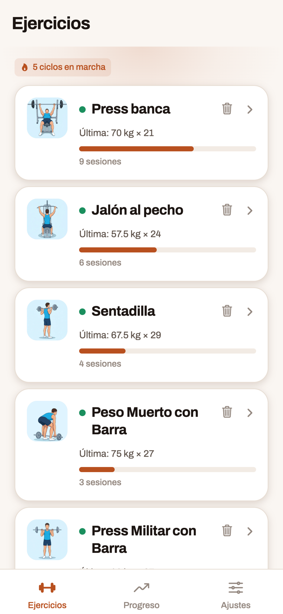<br><sub>Ejercicios</sub></td>
    <td align="center" width="33%">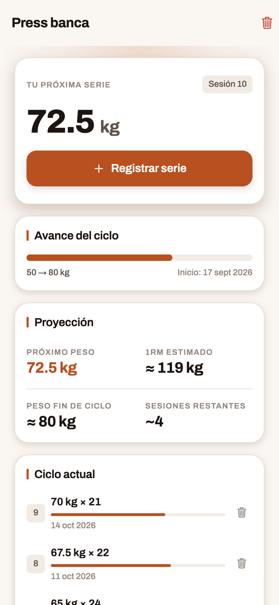<br><sub>Próxima serie y proyección</sub></td>
    <td align="center" width="33%">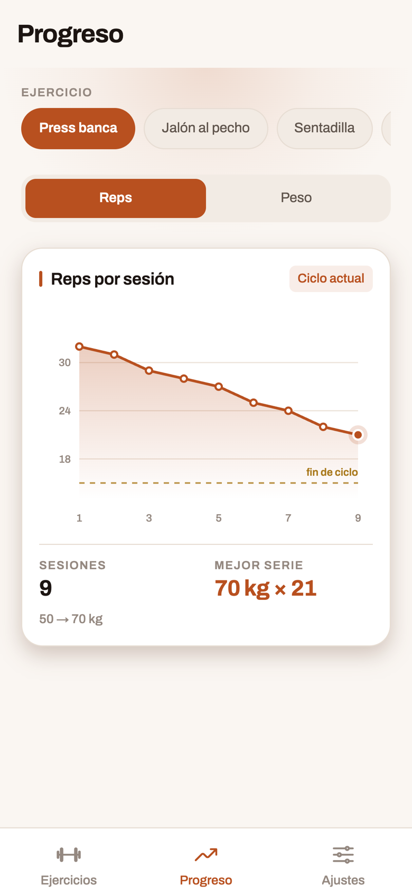<br><sub>Progreso</sub></td>
  </tr>
  <tr>
    <td align="center" width="33%">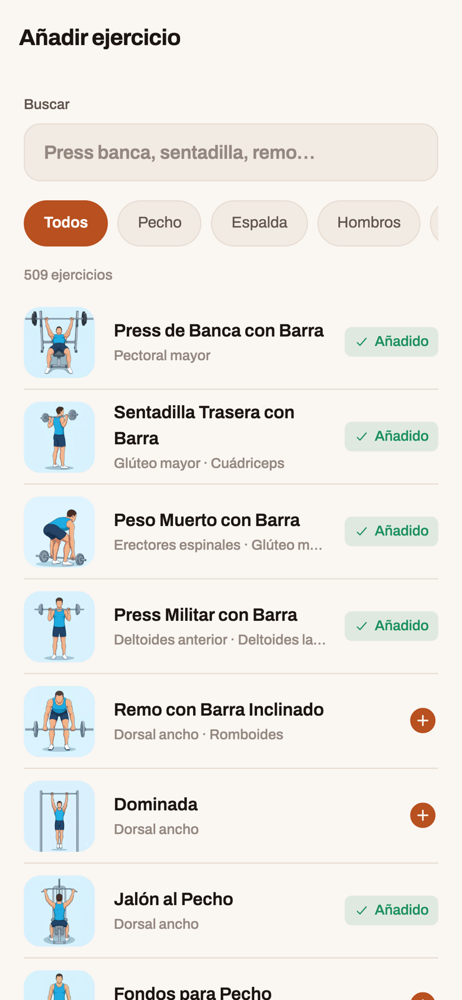<br><sub>Catálogo</sub></td>
    <td align="center" width="33%">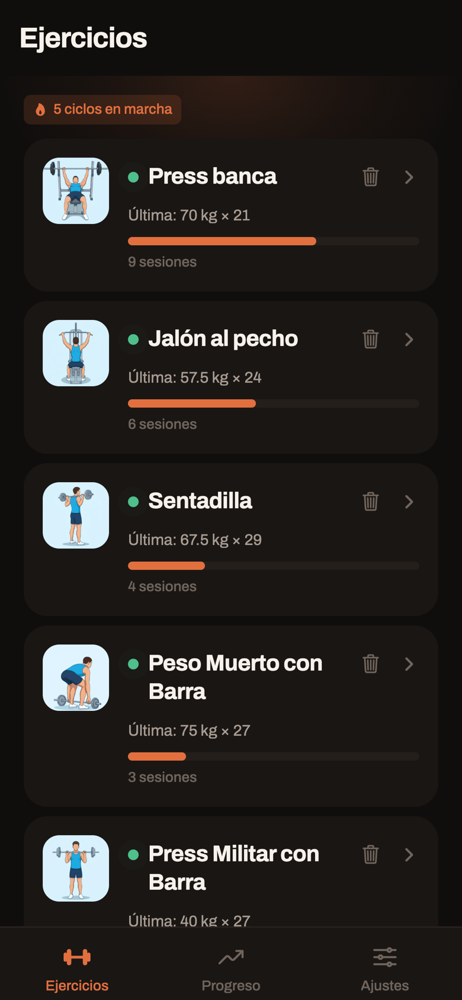<br><sub>Tema oscuro</sub></td>
    <td align="center" width="33%">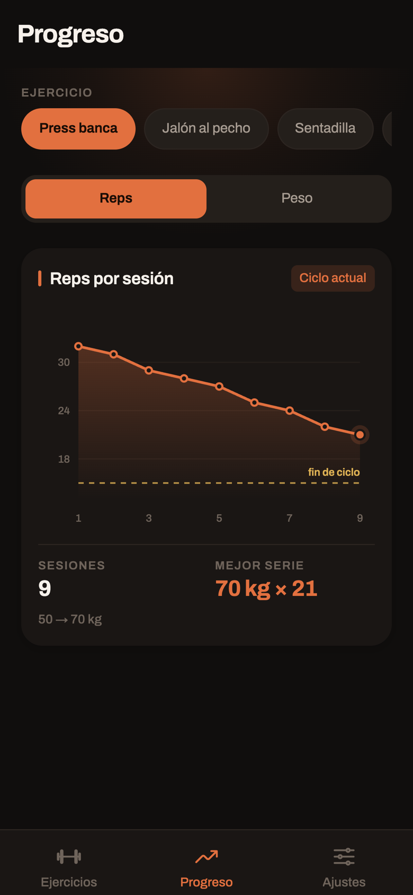<br><sub>Progreso, tema oscuro</sub></td>
  </tr>
</table>

### Web

<table>
  <tr>
    <td align="center" width="50%">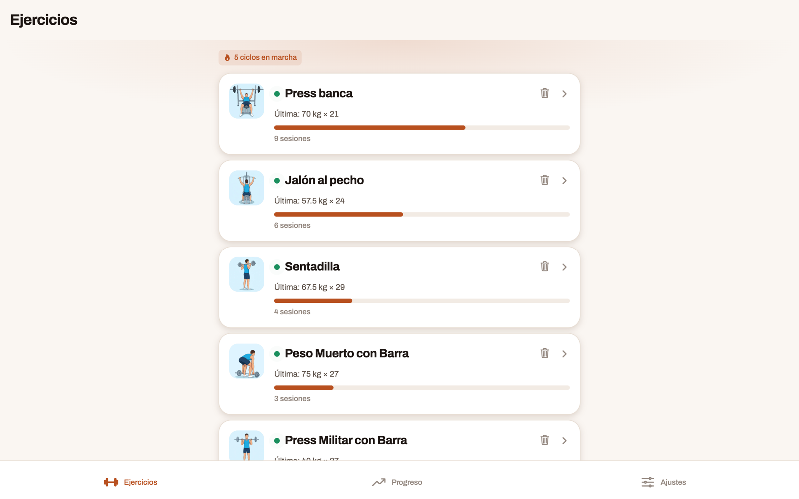<br><sub>Ejercicios</sub></td>
    <td align="center" width="50%">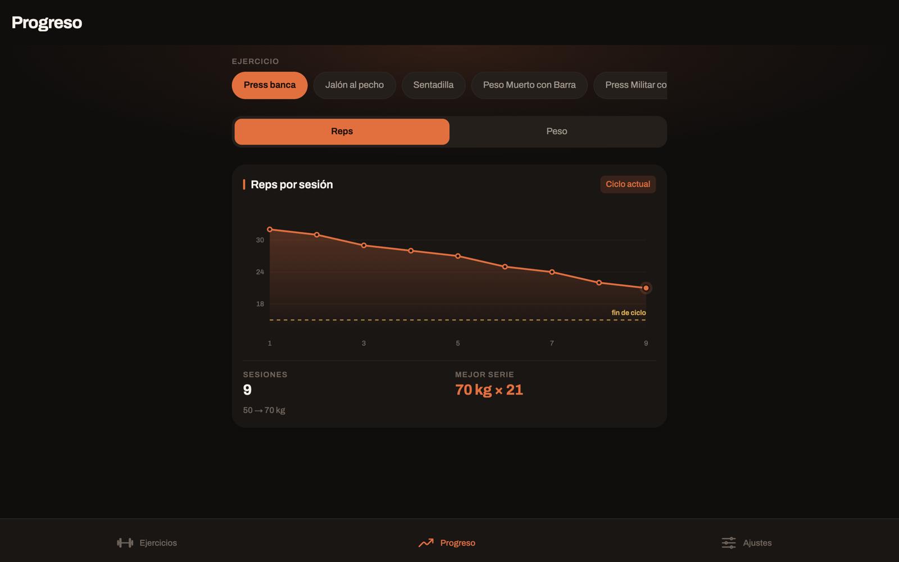<br><sub>Progreso, tema oscuro</sub></td>
  </tr>
</table>

### En acción

Grabado en el simulador de iOS (iPhone 17 Pro).

<table>
  <tr>
    <td align="center" width="33%">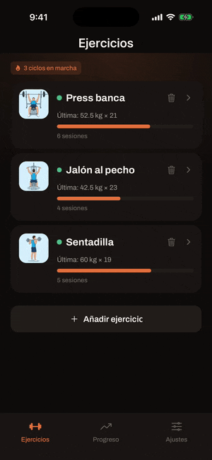<br><sub>Registrar una serie</sub></td>
    <td align="center" width="33%">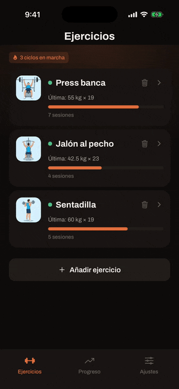<br><sub>Añadir un ejercicio del catálogo</sub></td>
    <td align="center" width="33%">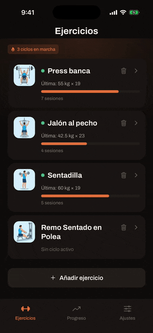<br><sub>Progreso por ejercicio</sub></td>
  </tr>
  <tr>
    <td align="center" width="33%">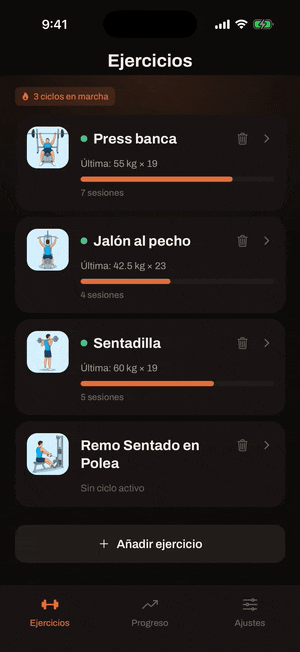<br><sub>Tema claro y oscuro</sub></td>
    <td align="center" width="33%">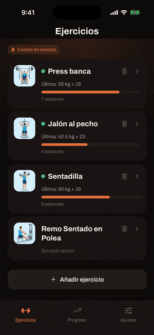<br><sub>Cuenta para sincronizar en la nube (opcional)</sub></td>
    <td width="33%"></td>
  </tr>
</table>

Capturas con datos de ejemplo. Las ilustraciones de los ejercicios son de
[RepDB](https://repdb.co) (ver [Créditos](#créditos)).

## Qué hace

- **Ejercicios con foto**: se eligen de un catálogo con buscador y filtros por
  grupo muscular, o se crean a mano.
- **Ciclos**: se arrancan desde el 1RM (la app calcula el 50 % redondeado al
  incremento) o desde un peso inicial. Unidad en kg o lb.
- **Sesiones**: registrar peso y repeticiones; la app propone el peso de la
  siguiente.
- **Progreso**: gráfica de repeticiones por sesión, 1RM estimado (Epley) y
  proyección del final del ciclo por mínimos cuadrados.
- **Sincronización opcional** con Supabase entre móvil y ordenador. Sin cuenta,
  todo se queda en el dispositivo.
- **Copia de seguridad local**: exportar e importar el progreso en un JSON
  (fusionando o reemplazando).
- Español e inglés, tema claro/oscuro.

## Puesta en marcha

Requisitos: Node 20 y npm.

```bash
npm install
cp .env.example .env   # opcional: solo hace falta para la sincronización
npm run web            # o: npm run android / npm run ios
```

Sin `.env` la app arranca igual, con la sincronización desactivada. Para
configurarla, sigue [SYNC.md](SYNC.md).

En móvil la app usa un **development build** (`expo-dev-client`), no Expo Go.
El perfil está en [`eas.json`](eas.json):

```bash
npx eas-cli@latest build --profile development --platform android
```

## Scripts

| Comando | Qué hace |
| --- | --- |
| `npm start` | Servidor de desarrollo de Expo |
| `npm run web` / `android` / `ios` | Arranca directamente en esa plataforma |
| `npm test` | Tests con Jest |
| `npm run lint` | ESLint |
| `npx tsc --noEmit` | Comprobación de tipos |
| `npm run build:web` | Export estático de la web en `dist/` |
| `npm run serve:web` | Sirve `dist/` en local |
| `npm run deploy` / `deploy:prod` | Publica la web en EAS Hosting (preview / producción) |

## Estructura

```
src/
  app/          pantallas (Expo Router, rutas por archivo)
    (tabs)/     Ejercicios, Progreso y Ajustes
  components/   componentes de UI compartidos
  lib/          lógica pura: método Bilbo, sync, merge, backup, catálogo
  store/        estado global (Zustand, persistido en el dispositivo)
  i18n/         traducciones es/en
  theme/        colores, tipografía y tema
  data/         catálogo de ejercicios generado
supabase/       esquema SQL con políticas RLS
scripts/        generador del catálogo
```

Las fórmulas del método viven en [`src/lib/bilbo.ts`](src/lib/bilbo.ts), sin
dependencias de React, para poder testearlas por separado.

## CI y despliegue

- **CI** ([`ci.yml`](.github/workflows/ci.yml)): en cada Pull Request comprueba
  tipos, pasa los tests y hace el build web.
- **Producción** ([`deploy-prod.yml`](.github/workflows/deploy-prod.yml)): al
  mergear un PR en `main`, despliega la web en EAS Hosting.
- **Keepalive** ([`supabase-keepalive.yml`](.github/workflows/supabase-keepalive.yml)):
  evita que el proyecto gratuito de Supabase se pause por inactividad.

Más detalle en [DEPLOY.md](DEPLOY.md) (web) y [SYNC.md](SYNC.md)
(sincronización, conflictos y cursores).

## Créditos

Exercise data by [RepDB](https://repdb.co) — el catálogo de ejercicios y sus
imágenes salen del [dataset gratuito de RepDB](https://github.com/RepDB/exercise-dataset),
cuya licencia pide esta atribución visible y prohíbe redistribuirlo como
dataset. Se regenera con `node scripts/build-exercise-catalog.mjs`.
